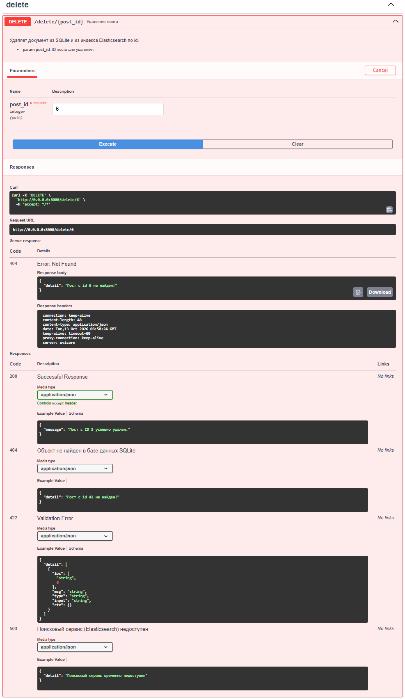
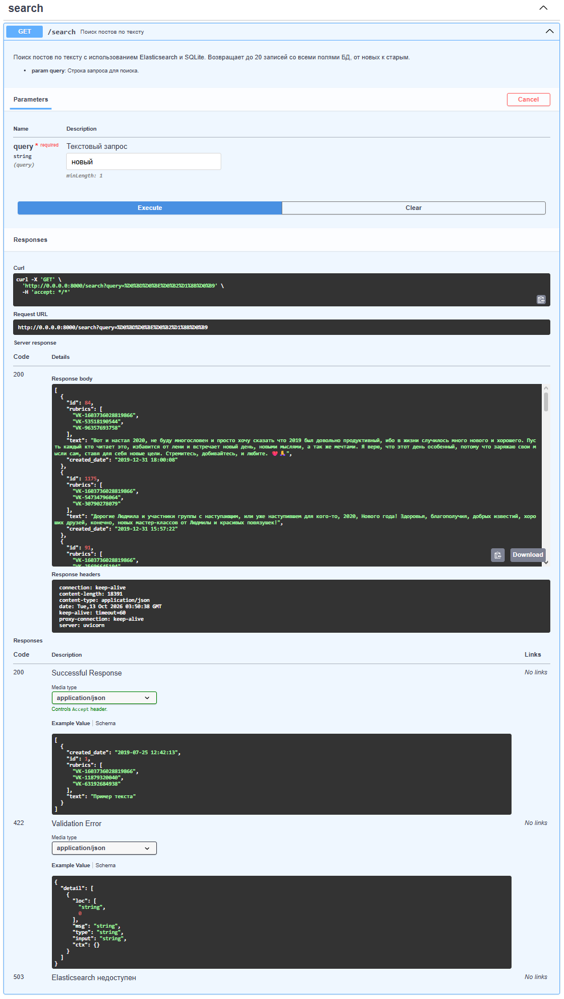
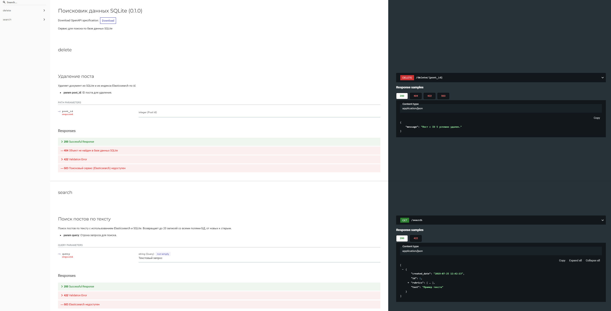

# Сервис полнотекстового поиска постов (FastAPI + SQLite + Elasticsearch)

Проект представляет собой асинхронное веб-приложение на базе **FastAPI**, реализующее систему хранения постов и полнотекстового поиска по их текстовому содержимому с использованием **Elasticsearch** и морфологического анализатора для русского языка.

<details>
  <summary>Нажмите, чтобы посмотреть картинку (delete api)</summary>
  
</details>

<details>
  <summary>Нажмите, чтобы посмотреть картинку (search api)</summary>
  
</details>

<details>
  <summary>Нажмите, чтобы посмотреть картинку (redoc)</summary>
  
</details>

---

## Запуск

### 1. Подготовка окружения
Убедитесь, что на вашем компьютере установлены и запущены **Docker** и **Docker Compose**

### 2. Запуск системы
Для автоматической сборки, инициализации базы данных и запуска веб-сервера выполните команду в терминале:

```bash
docker compose up
```

*Если вы хотите запустить проект в фоновом режиме (демоне), добавьте флаг `-d`:*
```bash
docker compose up -d
```

После завершения логов импорта веб-сервер станет доступен по адресу: **`http://localhost:8000`**.

---

## Интерактивная документация API

После успешного запуска проекта вы можете протестировать эндпоинты через встроенные интерактивные спецификации:
* **Swagger UI:** [http://localhost:8000/docs](http://localhost:8000/docs)
* **ReDoc:** [http://localhost:8000/redoc](http://localhost:8000/redoc)

### Основные эндпоинты:
* `GET /search?query=значение` — Полнотекстовый поиск. Запрос отправляется в Elasticsearch (русская морфология, сортировка по дате создания), после чего FastAPI отдаёт до 20 полных записей из SQLite.
* `DELETE /delete/{post_id}` — Удаление поста из SQLite и из индекса Elasticsearch. Если поисковый индекс недоступен, запись в SQLite не удаляется.

---

## Технологический стек
* **Backend:** Python 3.11, FastAPI, Uvicorn, Pydantic v2
* **База данных (Базовая):** SQLite (асинхронный драйвер `aiosqlite`, ORM `SQLAlchemy 2.1.4`)
* **Миграции:** Alembic
* **Поисковый движок:** Elasticsearch 8.11.1
* **Оркестрация и развертывание:** Docker, Docker Compose
* **Импорт данных:** Pandas

## Архитектура и Docker-окружение
Проект полностью контейнеризирован и разделен на изолированные слои для обеспечения отказоустойчивости и соответствия стандартам разработки:
1. `es_container` — Сервис поискового движка Elasticsearch.
2. `fastapi_db_init` — Инициализирующий технический контейнер (`init-container`). При первом запуске он автоматически накатывает миграции Alembic, скачивает исходный CSV-датасет с Яндекс Диска, наполняет SQLite и индексирует тексты в Elasticsearch, после чего успешно завершает работу (`Exited 0`).
3. `fastapi_web` — Основной контейнер веб-сервера FastAPI. Стартует строго после успешного завершения фазы инициализации данных.

Данные SQLite сохраняются в изолированном именованном томе `sqlite_data`, что предотвращает их потерю при перезапуске или обновлении контейнеров.
